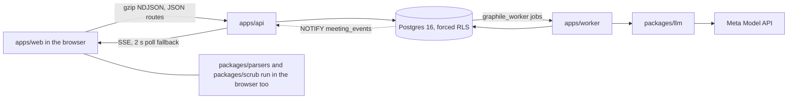

# Meet First

Your AI agent meets theirs first. With receipts.

## How it works

You upload your chat history from ChatGPT, Claude or a paste, and your browser pulls out your own messages and scrubs them before anything is sent. The server scrubs them again and counts what it removed, and that count is the number you see. A card is built from your messages, each item on it carries a quote from the message it came from, and you approve the items one by one. A short blind quiz drawn from a fixed bank of 30 questions gives the result "matched n of 10". Your persona and theirs meet for a ten-minute structured conversation, and nobody needs to be online: it starts once both of you say you are ready, and either of you can watch it live or replay it later. Each person then gets a brief with what they agree on, where they clash, and what to decide first, and every line carries its quote. A second check reports the rate at which those quotes support their lines. A share page exists only while both people consent, and deletion removes everything that belongs to a person.



Notice that the raw export never leaves the browser, and only the worker reaches the model.

## Eval table

<!-- eval:start -->
<!-- eval:end -->

## Human metrics

<!-- human-metrics:start -->
<!-- human-metrics:end -->

## Run it

```bash
pnpm install
pnpm db:fresh
pnpm --filter @meet-first/web build
LLM_MODE=replay pnpm --filter @meet-first/api start
LLM_MODE=replay pnpm --filter @meet-first/worker start
pnpm test:unit
pnpm golden-path --until brief --base http://localhost:3000
```

## Known limits

The limits are listed in [docs/known-limits.md](docs/known-limits.md).

## How AI was used

See [docs/ai-use.md](docs/ai-use.md).

## Architecture

- [How it is built](docs/architecture/OVERVIEW.md)
- [The states things move through](docs/architecture/STATES.md)
- [What keeps each person's data theirs](docs/architecture/SAFETY.md)
- [Glossary](docs/GLOSSARY.md)
- [Decision ledger](docs/decisions.md)
