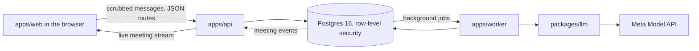

# Meety

Your Meety meets theirs first. With receipts.

Meety builds an AI of you from your own chat history, using only the parts you approve. Before two people spend an evening, a weekend or a company on each other, their two Meetys talk first and play out how the two of them would probably react: would they get along, could one help the other, would they agree on a deal. Each person gets a short brief, and every line of it quotes the words it rests on. Meety never scores a person.

It is live at [meet-first.onrender.com](https://meet-first.onrender.com). The app was called Meet First until November 2026, so the code, the packages and the database still use that name.

## Try it

1. Open the site and choose **Continue with Google**. It runs on a free plan, so the first visit after a quiet spell can take about a minute.
2. Home is your feed. Six sample people are already on it: Maya, Priya, Ravi, Jun, Leila and Tomas. They are made up, marked Sample, and accept a friend request at once.
3. Add one of them as a friend, open Meety, and ask how they would react to something, such as "would Maya enjoy a weekend hackathon?". Meety plans the question and waits for your press; Maya's Meety then answers from her notes and quotes them.
4. To make your own Meety, upload a ChatGPT, Claude or Codex export, or paste your notes. Your browser keeps only your own messages and removes secrets and contact details before anything is sent. You approve your card item by item.
   You can also copy Meety's prompt into your own ChatGPT or Claude and paste the summary it writes; Meety checks each of its quotes against your own messages, and **Try your Meety** on your profile asks it a question about you.
5. Once your card is approved, open someone's profile, press **See how you'd get on** and pick a question. The two Meetys talk for about ten minutes; watch it live or read the brief afterwards.

You can also post photos and 24-hour stories, and like other people's posts. Nobody sees a count of your likes.

## How it works

Your browser reads the export, keeps your own messages, and scrubs them; the server scrubs them again and stores how many things it removed, which is the number you see. A model builds your card from those messages, and each card item carries the quote it came from. When two people meet, each Meety speaks from its own card, and every claim it makes carries a quote from a message or is marked as having none. Code checks every quote word for word against the message it names, and a second model call reports how often the brief's quotes back their lines.



The raw export never leaves the browser, and only the worker talks to the model.

The model never decides what is stored, what is public, or what is deleted. Those rules are code, and Postgres enforces them: every table has row-level security, and the api and the worker run each piece of work as the person it acts for, so they see only what that person may see. Deleting an account removes everything that belongs to that person.

<!-- eval:start -->
<!-- eval:end -->
<!-- human-metrics:start -->
<!-- human-metrics:end -->

## Built with

TypeScript throughout, in one pnpm workspace. React 19 and Vite in the browser; Fastify 5 for the api; Graphile Worker for background jobs; Postgres 16 through Kysely; zod schemas shared by all three. The model is Meta's muse-spark-1.3 through the Meta Model API, and muse-image-1.0 draws the comic of a meeting.

| Folder | What it holds |
|---|---|
| `apps/web` | The browser app, including reading and scrubbing chat exports |
| `apps/api` | The web server: sign-in, uploads, every route, and the live meeting stream |
| `apps/worker` | Background jobs: cards, quizzes, meetings, briefs, comics and deletion |
| `packages/contracts` | The schemas of every route, event and job |
| `packages/db` | Migrations, row-level security policies and database types |
| `packages/llm` | The one door to the model, with daily and total spend caps |
| `packages/prompts` | Every prompt, versioned, with its test cases |
| `packages/parsers`, `packages/scrub` | Reading exports and removing secrets, in the browser and again on the server |
| `packages/receipts` | Checking a quote against the message it names |
| `packages/evals` | The eval runner and recorded model replies |

## Run it

You need Node 22 and pnpm 9 (versions in `mise.toml`), Postgres 16, and a `.env` made from `.env.example`. `LLM_MODE=replay` answers every model call from recorded replies, so no Meta key is needed.

```bash
pnpm install
pnpm db:fresh
pnpm --filter @meet-first/web build
LLM_MODE=replay pnpm --filter @meet-first/api start
LLM_MODE=replay pnpm --filter @meet-first/worker start
```

Then open http://localhost:3000. `pnpm golden-path --until brief --base http://localhost:3000` walks two people from sign-up to a finished brief.

## Tests

`pnpm test:unit` and `pnpm test:accessibility` need nothing else. The integration, security, reliability and journey suites need the database:

```bash
pnpm test:integration
pnpm test:security
pnpm test:reliability
pnpm test:journeys
```

`pnpm lint`, `pnpm -r typecheck` and `pnpm checks` run the same checks as CI.

## More

- [How it is built]
- [The states things move through]
- [What keeps each person's data theirs]
- [What Meety does not do]
- [How AI was used]
- [Privacy](https://meet-first.onrender.com/privacy), [terms](https://meet-first.onrender.com/terms) and [cookies](https://meet-first.onrender.com/cookies)
