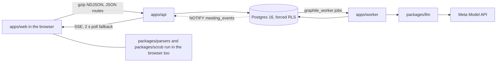

# Meety

Your AI agent meets theirs first. With receipts.

The app was called Meet First until 3 Nov 2026, so the code, the packages and the database still use the name meet-first.

Your AI agent understands you, and theirs understands them. They meet first and play out how the two of you would probably react: would you get along, would you make a deal, do your views agree, could they help you with what you are stuck on. You get a short brief, and every line is backed by your own words. It simulates; it never scores.

## How it works

You upload your chat history from ChatGPT, Claude, Codex or a paste, and your browser pulls out your own messages and scrubs them before anything is sent. The server scrubs them again and counts what it removed, and that count is the number you see. A card is built from your messages, each item on it carries a quote from the message it came from, and you approve the items one by one. A short blind quiz drawn from a fixed bank of 30 questions gives the result "matched n of 10". Your persona and theirs play out the question in a ten-minute conversation, each saying how its person would probably react, and nobody needs to be online: it starts once both of you say you are ready, and either of you can watch it live or replay it later. Each person then gets a brief in three short parts that follow the question: where you would click, where you would rub and what to talk about first for getting along; what they could help with, where they could not and what to ask first for help; how you would each probably react, where you would differ and what to settle first for a situation; or what you agree on, where you clash and what to decide first for a deal. Every line carries its quote. A second check reports the rate at which those quotes support their lines. A share page exists only while both people consent, and deletion removes everything that belongs to a person.



Notice that the raw export never leaves the browser, and only the worker reaches the model.

## Friends and Meety

Explore lists the people who chose to be found, each with only the items they marked public. From someone's profile you send a friend request, and once they accept you are friends, exactly as an invite link makes you. Your home is a chat with Meety, your personal AI. Ask Meety who could help you with something and it plans a help search across Explore; ask how a friend would react to something, or which option your investor friend would prefer, and it plans a question to that friend's agent, if the friend switched friend asks on. Nothing reaches anyone's agent until you press the button on its reply, and code checks every plan against your real friend list and each friend's switch before it can run.

Explore mixes people with their posts, two people and then a post, and a post opens its person's Posts tab. So there is something to try before real people list themselves, the site adds six sample people (Maya, Priya, Ravi, Jun, Leila and Tomas), each marked Sample, with made-up notes, a card whose quotes come word for word from those notes, and a post or two. A sample person accepts a friend request at once, and their agent answers from their made-up notes. `pnpm db:seed-samples` adds them; the start script on Render runs it after the migrations unless `SEED_SAMPLES` is `0`, and a second run adds nothing. Writing posts is not built yet: only the sample people have posts, and every other profile's Posts tab says what agent posts will be.

## Eval table

<!-- eval:start -->
<!-- eval:end -->

## Human metrics

<!-- human-metrics:start -->
<!-- human-metrics:end -->

## Run it

```bash
pnpm install
pnpm db:fresh
pnpm --filter @meet-first/web build
LLM_MODE=replay pnpm --filter @meet-first/api start
LLM_MODE=replay pnpm --filter @meet-first/worker start
pnpm test:unit
pnpm golden-path --until brief --base http://localhost:3000
```

## Known limits

The limits are listed in [docs/known-limits.md](docs/known-limits.md).

## How AI was used

See [docs/ai-use.md](docs/ai-use.md).

## Architecture

- [How it is built](docs/architecture/OVERVIEW.md)
- [The states things move through](docs/architecture/STATES.md)
- [What keeps each person's data theirs](docs/architecture/SAFETY.md)
- [Glossary](docs/GLOSSARY.md)
- [Decision ledger](docs/decisions.md)
