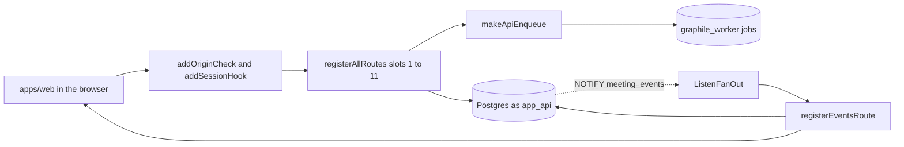
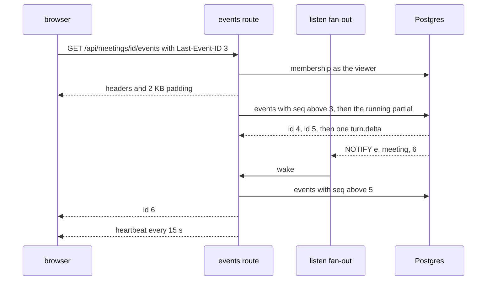

# apps/api

## What this does

The api is the one web server of Meet First. It answers every route under `/api`, serves the built web app at `/`, and streams each meeting to the two people in it. Every request that acts for a person runs as the database role `app_api` inside one transaction that names that person, so row security decides what it can read. Rows D32, D33, D48 to D54, D56, D67, D69, A5, A7, R8.1 to R8.7, R9.2 to R9.5, R12.5.

## What this never does

- It never calls the model, never imports `packages/llm` and never reads `META_API_KEY`.
- It never stores a session token, a transfer token, an invite token or a recovery code, only their sha256.
- It never puts the session token in a response body, a URL or a log line.
- It never accepts a POST, PUT, PATCH or DELETE whose `Origin` header is not `APP_ORIGIN`.
- It never answers a non-public `/api` route without a live session.
- It never compresses a response, so no compressor can hold back the meeting stream.

## How it fits

Notice that a NOTIFY only wakes a stream; the stream then re-reads the rows under the viewer's own session, so a wrong meeting yields nothing.

Notice that the reconnect starts at 4, never at 3, and that the delta carries no id.

## The main pieces

- `src/server.ts`: env, logger, hooks, the route slots in order, boot and shutdown.
- `src/app-types.ts`: `RouteDeps`, `RoutePlugin` and `request.personId`, shared by every route folder.
- `src/job-queue.ts`: `makeApiEnqueue`, the job queue the routes use.
- `src/route-errors.ts`: the error shape every refusal is sent in.
- `src/sessions/`: the cookie, the Origin check, the account limit, sign-up, recovery, transfer, claim and deletion.
- `src/pairs/`: invites, joining and the lobby poll.
- `src/meeting-stream/`: the LISTEN connection, the stream and the poll fallback.
- `src/web-pages/`: the web build, the app-shell fallback, the CSP header and `/api/health`.
- `src/testing/`: `buildTestApp`, `cookieJar` and `readSse` for every api test.

## How to test it

`pnpm test:unit apps/api && pnpm test:security apps/api && pnpm test:integration apps/api/src/sessions apps/api/src/pairs apps/api/src/meeting-stream apps/api/src/web-pages`

The app shell is served as `text/html; charset=utf-8`; error log lines are pino level 50.

Not built yet: the source, card, quiz, meeting, brief, comic and share routes, which arrive with their builders through requests that fill their slots in `server.ts`; the `delete_person` job (deletion, Wave 2).
