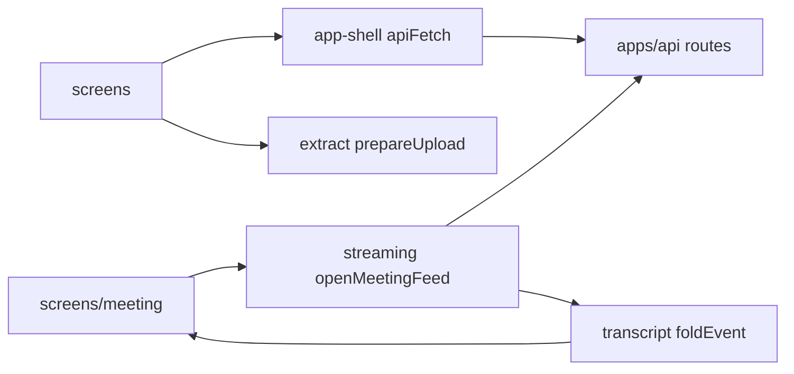

# apps/web
## What this does

The browser app of Meety. A person uploads what their AI assistant knows about them, checks the names and the card, takes the quiz, pairs with someone, and watches the two personas meet. The api serves it from the same address, so the session cookie never reaches JavaScript.

## What this never does

- It never calls a model and never imports packages/llm.
- It never keeps a token in local storage, session storage or a variable; the session is an HttpOnly cookie.
- It never makes anyone stay online for a meeting; the server starts it once both people have said ready.
- It never renders model text as HTML; links, images and tags stay plain text.
- It never sends the raw export; ingest's Web Worker prepares the excerpts and only those are posted.

## How it fits

Notice that the meeting screen never reads the stream itself: every event and poll reply passes through one fold, so a reconnect or a poll cannot show a different meeting.

## The main pieces

- src/app-shell: routes, apiFetch and ApiError, the server clock, what a tab remembers, the screen frame.
- src/streaming: the fetch-based event stream, the 2 s poll fallback and the reconnect schedule.
- src/transcript: the event fold, the partial-text rule, the allow-list markdown renderer and the replay player.
- src/screens: one folder per screen; the card screen's Sharing section holds the friends, directory and dating switches and the public items, and the directory screen lists the people who opted in and starts a meeting with one.
- src/testing: the MSW stubs, the 375 px render, the fixtures and the fake event stream.

## How to test it

`pnpm test:unit apps/web && pnpm test:accessibility apps/web && pnpm --filter web build`

Not built yet: a screen that plays an exported meeting with the replay player.
