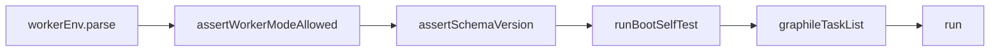

# @meet-first/worker

The background worker. It starts Graphile Worker with every job of the product after it has checked the environment, refused replay in production, checked the database schema version and run the model self-test.

## What this does

The background worker. It starts Graphile Worker with every job of the product after it has checked the environment, refused replay in production, checked the database schema version and run the model self-test.

## What this never does

It never serves a web route, never runs a migration, never starts when the self-test refuses a schema, and never registers a task that a feature folder does not export.

## How it fits

Notice that the self-test runs before any task is registered, so a bad schema stops the worker at boot, not mid-meeting.

## The main pieces

`src/runner.ts` holds the boot order, the task slots and the crontab filter. `src/job-context.ts` builds the context every job gets, the payload wrapper and the enqueue. `src/cards/` holds the names pass (`scrub-names-job.ts`), the card build (`build-card-job.ts`), the sampler, the quote check and the request builders. `src/quizzes/` holds the persona answers and the blind judge of the knows-me quiz. `src/meetings/` holds the meeting jobs: one persona turn per `meeting_step`, the stalled-meeting sweeper that also starts ready meetings, and the question check that builds the prompt prefixes. `src/asks/` holds the `run_ask` job: the question check of a help search or a friend ask, the answer rows, one persona answer for each listed persona or friend, and the support check that places the help answers. `src/retention/` holds the account deletion (`delete-person-job.ts`), the hourly purge (`purge-expired-job.ts`) and the table list that the deletion counts rows with (`table-list.ts`). `src/testing/` holds the test runner, the fake clock, the recorded reply helpers, the fixture cases and the golden path rules.

## How to test it

`pnpm test:unit apps/worker/src` and `pnpm test:integration apps/worker/src/cards`.

Not built yet: the brief and comic task lists; each lands with its Wave 2 builder.
