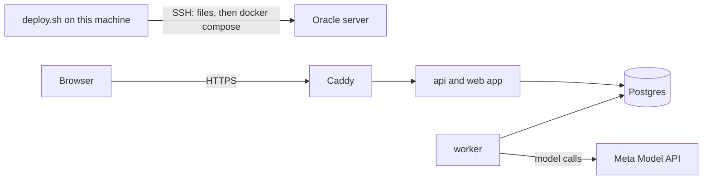

# deploy/oracle

Rows D70 and D71 on one Oracle Cloud server (Always Free: Arm, 2 cores, 12 GB) instead of Render. `render.yaml` stays as the paid fallback.

## What this does

It runs Meety on one server: Postgres, the api (which also serves the web app), the worker, and Caddy, which gives the server an HTTPS name on sslip.io and renews its certificate. `deploy.sh` deploys a tag on the release branch from this machine over SSH, and its first run sets the server up.

## What this never does

It never opens Postgres to the internet, only to the server itself for the production check through an SSH tunnel. It never prints a password or the Meta key, never deploys a tag that is not on the release branch, and never starts the worker before the api has applied the migrations.

## How it fits

Notice that the browser reaches only Caddy, and only the worker talks to the model, as on Render.

## The main pieces

- `compose.yaml`: the four containers, their order (Postgres healthy, then the api, which migrates before it listens, then the worker), and the stop delay that lets a model call finish.
- `Caddyfile`: HTTPS for the server's sslip.io name, in front of the api, with the meeting stream passed through unbuffered.
- `make-roles.sh`: the four roles and the database on Postgres's first start, owned by app_migrate as in a local rebuild.
- `set-up-server.sh`: ports 80 and 443 in the server's own firewall, Docker from Ubuntu's packages, the folders, and the nightly backup.
- `deploy.sh`: the deploy itself, the secrets file on the first run, the wait for health, and `.env.wave3` for the production check.

## How to test it

Put `ORACLE_HOST=<the server's public IP>` in `.env.oracle` at the repository root, then run `deploy/oracle/deploy.sh <tag>` with a tag on the release branch. It ends by printing the health answer, which must show `"db":true`, `"worker":true` and the newest migration's number. For the full check, open the tunnel the script prints, then run `scripts/check-wave-3.sh`.
