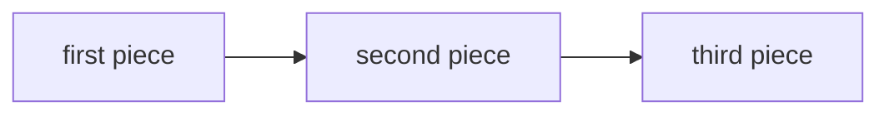

# <Package name>

Every builder copies this file to its package and replaces each placeholder. The five headings stay in this order.

## What this does

Say what this package does, in two short sentences a stranger can follow.

## What this never does

List the things this package must never do, such as reading the network or writing to a table it does not own.

## How it fits

Notice one thing in this picture, in one sentence.

## The main pieces

List the main files and folders, with one line each on what they hold.

## How to test it

Give the exact command, such as `pnpm test:unit <package path>`.

Not built yet: name what this package does not do yet, or write "nothing" when that is true.
