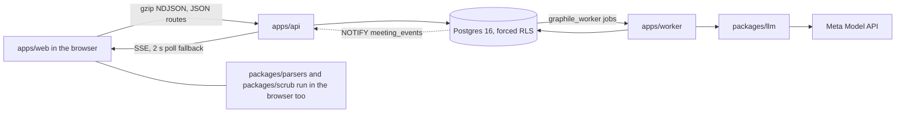
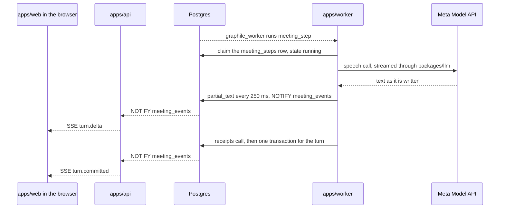
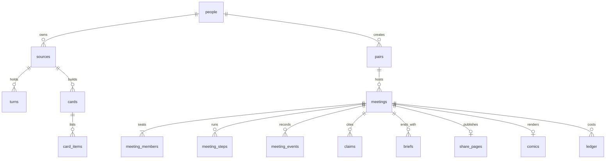

# How Meety is built

Two people each upload what their AI assistant knows about them. The browser extracts the turns and runs a first scrub, so the raw export never leaves the device. The api scrubs the turns again, stores them, and queues the work. The worker builds a card for each person, runs a ten-minute meeting between the two personas, and writes each person a brief with a support check on every line. A share page exists only while both people consent, and deletion removes every row that belongs to a person.

## The pieces and who talks to whom

Notice that the raw export never leaves the browser, and only the worker reaches the model.

## One request from start to finish: a meeting turn

Notice that the claim row, not the job queue, decides who may run a step, and that a turn and the next step commit together.

The worker writes the turn and its next step in one transaction, so a turn is either fully stored with its next step or not stored at all. A worker that dies before that commit leaves the step row in state running. The sweep_stalled job marks a running step stalled once a meeting has had no event for 150 seconds, and a new meeting_step job claims it. The browser never decides what a turn says. It folds the events it receives, and it can replay them later from the stored rows. The state of each step, meeting and card is listed in STATES.md.

## Where the data lives

Notice that most tables hang off people or meetings, so one delete of a person reaches every row that belongs to them. Ledger rows stay, with their person and meeting ids cleared.

Some of the other tables, with the migration that makes each:

| Table | What it holds | Defined in |
|---|---|---|
| redactions | One row per scrubbed span, with its placeholder id | migration 0001 |
| names_passes | One row per source once its names pass has finished | migration 0002 |
| source_names | One row per third-party name found, until the names review | migration 0002 |
| quizzes, quiz_items | One blind quiz per card, with persona and human answers | migration 0001 |
| quiz_bank | The fixed bank of 30 quiz questions (reference table) | migration 0001 |
| comic_panels | The six panels of a comic, stored as webp | migration 0001 |
| sessions, transfer_links | Login sessions, and single-use links to move a session | migration 0001 |
| deletions | A record of what a deletion removed, by table | migration 0001 |
| service_heartbeats | The last time each service reported in (reference table) | migration 0001 |
| schema_migrations | Which migrations have run | packages/db |
| recall_corpus | A view of the turns that meeting recall may search | migration 0001 |

Every table has row security turned on and forced. Two reference tables can be read by anyone; for every other table, a query that sets no person and no meeting returns no rows.

## Where to read next

- STATES.md lists the states of a source, card, quiz, meeting, step and comic.
- SAFETY.md lists who may read which rows, what leaves the device, and how consent and deletion work.
- ../GLOSSARY.md defines each word the code and the documents use.
- ../known-limits.md lists what Meety does not do.
- ../ai-use.md says how AI was used to build the product and what runs in it.
