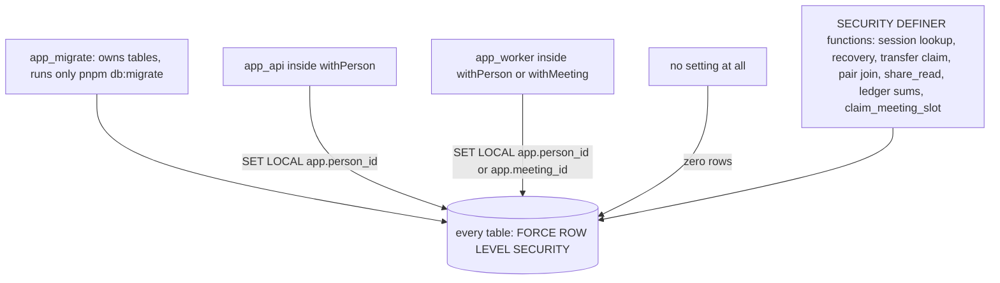
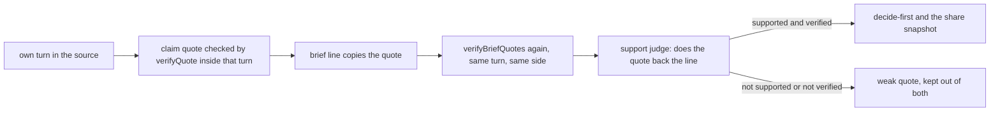

# What keeps each person's data theirs

## Who may touch what

Notice that a request that forgets to set a person sees nothing, and the only way around that is one of the named functions.

Every table is read through a policy that names the person or the meeting in the current transaction. The policies, by the shape of the rule they apply:

| Policy shape | Tables |
|---|---|
| `person_id = app_person()` only | sessions, transfer_links, redactions, deletions, names_passes, source_names |
| `person_id = app_person() OR app_meeting_person(person_id)` | people (on id), sources, turns, cards, card_items, quizzes, quiz_items |
| `creator_person_id = app_person() OR joiner_person_id = app_person()` | pairs |
| `meeting_id = app_meeting() OR app_is_member(meeting_id)` | meetings (on id), meeting_members, meeting_steps, meeting_events, claims, comics, comic_panels, share_pages |
| `person_id = app_person() OR meeting_id = app_meeting()` | briefs, so each person reads only their own brief |
| `person_id = app_person() OR meeting_id = app_meeting() OR app_is_member(meeting_id)` | ledger |
| `USING (true)`, read only | quiz_bank, service_heartbeats |

Three rules narrow the table above as built. The api role cannot read the `frozen_prefix` column of meeting_members; the worker reads and writes that column. On people, sources, turns, cards, card_items, quizzes and quiz_items, a meeting job can read both members' rows, but it cannot change or delete the other member's rows. The api role never inserts, moves or deletes a membership row; a meeting's two member rows are made by one function when the meeting is created.

When a query must read rows that the policies hide, it calls one of the SECURITY DEFINER functions below. There are sixteen, all owned by the app_definer role, and PUBLIC may run none of them:

| Function | What it does |
|---|---|
| auth_person_for_session | Finds the person for a live session token hash, or nothing. The api calls it before it sets any person. |
| auth_create_person | Makes a person and their first session from hashes only. |
| auth_claim_transfer | Spends a transfer link once and opens a new session for its owner. |
| auth_redeem_recovery | Spends a recovery code once and opens a new session. |
| pairs_join | Joins a pair with an invite token hash, in one conditional update. |
| share_read | Returns the public snapshot of a share page while both consents stand and nobody has revoked it. It never returns ids. |
| share_revoke | Stamps revoked_at on the share page with the given slug. It returns true the first time and nothing after. |
| ledger_window | Adds up tokens and calls over the last n seconds, for the rate limit. |
| ledger_usd_since | Adds up dollars since a time, for the daily and total caps. |
| ledger_meeting_tokens | Adds up the tokens one meeting has used, for the per-meeting stop. |
| claim_meeting_slot | Starts a meeting when fewer than the running limit are running, and queues it otherwise. |
| meeting_create | Makes a meeting and its two member rows. The creator is side a. |
| sweep_candidates | Lists the meetings the sweeper must look at: queued ones by position, and ready ones whose two people have both given their go-ahead. |
| pair_display_names | Returns the two display names of a pair to its own members, and nothing else of either person. |
| purge_expired_rows | The hourly purge: expired transfer links, unjoined pairs after 24 hours, and comics after 30 days unless their share page is published. |
| app_shares_meeting | Tells the membership policy whether two people share a meeting, so the policy never reads its own table. |

## What leaves the device, and what never does

| Data | Leaves the device | Reaches the model | Shown to the public |
|---|---|---|---|
| The person's own turns | Yes, after canonicalisation and the browser scrub, as gzip NDJSON | Yes, scrubbed: card build, names pass and recall results | Only inside the share snapshot, while both consents stand |
| The raw export file | Never | Never | Never |
| Third-party turns | Never | Never | Never |
| Code fence contents | Never | Never | Never |
| Quiz answers and quiz tables | Yes, the answers | Never | Only inside the share snapshot, while both consents stand |
| Committed turns of both personas | Not applicable: written on the server | Yes, both personas' turns go back into the prompt | Only inside the share snapshot, while both consents stand |
| Brief lines | Not applicable: written on the server | Yes, the support check reads each line with its quote | Only the lines the support check marked supported, and only inside the share snapshot |

## The scrub, twice

The browser runs the scrubber to show a preview, and the api runs the same rules again as the authoritative pass that writes the redactions rows (D11). The number on screen is the count of those rows, so the preview cannot disagree with what is stored. A code fence is stored as a placeholder with its language and line count, never as its text (D13). Each redaction is a placeholder with a category and an eight-character id, and no offsets are stored, because the text is rewritten twice and offsets would drift (D14). The names pass in the worker replaces third-party names with role tokens after the rules have run (D15), and a person may not build a card until the names review has frozen the source (D16).

## Consent

The copy shown before an upload is this sentence, word for word (A3):

> Your original archive stays on your device. After you review redactions, we upload and store only the selected excerpts shown here. You can delete them at any time.

A share page is served only while both consent flags are true and revoked_at is empty. Either person can withdraw their consent, and the page then returns nothing on the next request. A report on a share page writes revoked_at through the share_revoke function (migration 0003), which a human reviews.

The recall switch on a card shows this text, word for word (R7.1):

> Let my agent search my notes during meetings, with names hidden and secrets removed. The other person may see quotes from them.

## Deletion

`DELETE /api/people/me` sets the person's state to deleted, revokes their sessions, clears their cookie, queues the delete_person job, and answers 202 with a deletion id. The job then:

1. Sets every meeting of the person to deleted. A step that finds its meeting deleted exits, and that counts as success.
2. Lets the foreign keys cascade, which removes the person's sources, turns, redactions, cards, items, quizzes, pairs, meeting members, steps, events, claims, briefs, comics, panels and share pages.
3. Clears the person and meeting ids on their ledger rows, so the cost record stays without the link to a person.
4. Deletes the people row, and writes the count of rows removed from each table to the deletions record.

The other person keeps their own source and card, and the screen says so (R9.7).

## The browser side

The session cookie is named `__Host-session`. It is HttpOnly, Secure, has Path=/ and SameSite=Lax, and has no Domain attribute, which the browser needs for the `__Host-` prefix (A7, D33). The api checks the Origin header on every request that is not a GET. The Content-Security-Policy string is, word for word (D67):

> default-src 'self'; img-src 'self' data:; connect-src 'self'

Markdown from the model renders only text, emphasis, lists and blockquotes. Links, images and HTML are not rendered (D66). Before any text is stored, canonicalisation removes the Unicode format and control characters (Cf and Cc), except the newline and the tab, so hidden characters cannot carry an instruction past the scrubber (D6, R7.7).

## How a brief line is protected from start to finish

Notice that a quote shows where words came from; the judge is a second, separate check that they support the line, and it is reported as a rate, never as a guarantee.
