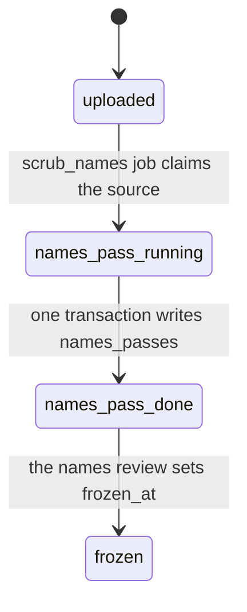
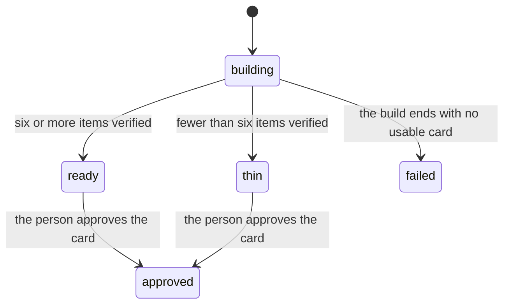
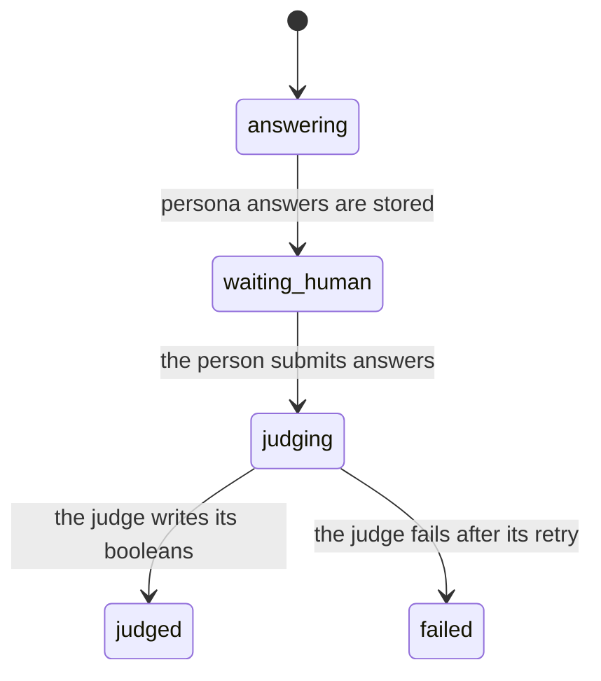
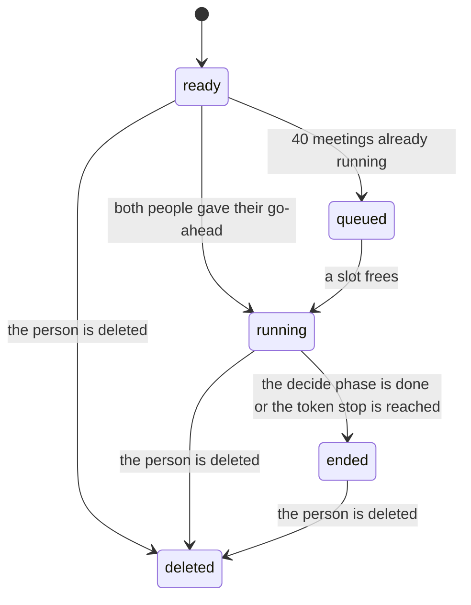
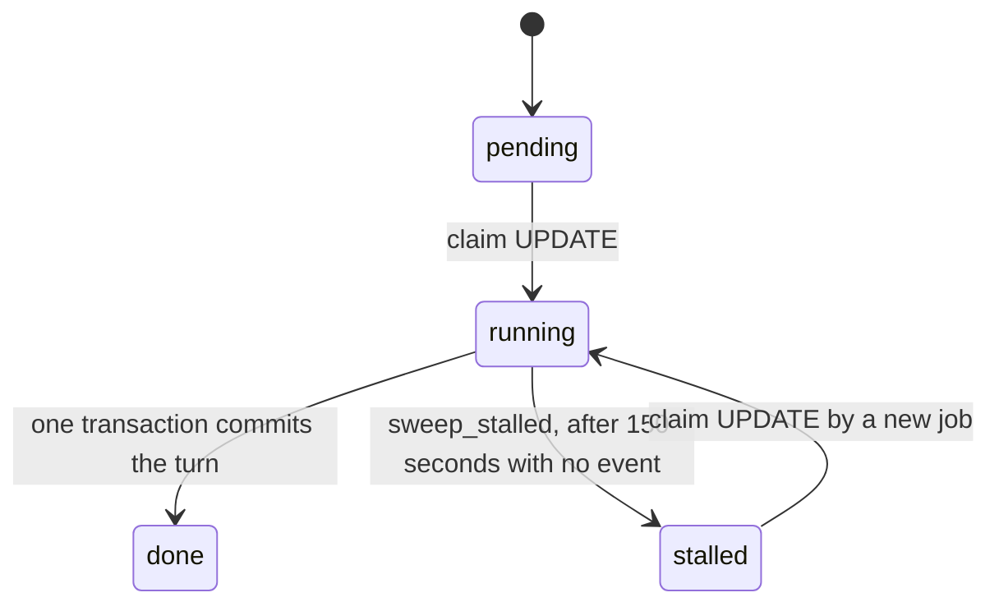

# The states things move through

Each diagram shows one thing. The state names are the values stored in the database, so a reader can search for them. The table under each diagram names the trigger for each move and the statement or job that makes it.

## A source

Notice that frozen is the only state a card can be built from; turn text cannot change after it.

The sources table has no state column. A source is uploaded when its row exists, names pass done when a names_passes row exists, and frozen when frozen_at is set.

| Move | Trigger | Made by |
|---|---|---|
| uploaded to names_pass_running | the names check starts on the source | scrub_names job, as the source's person |
| names_pass_running to names_pass_done | the names check finishes | the same transaction writes the names_passes row and the source_names rows |
| names_pass_done to frozen | the person sends the names review | names review route sets frozen_at; a trigger refuses it until the names_passes row exists |

## A card

Notice that thin still reaches approved; the meeting shows a badge instead of pretending.

| Move | Trigger | Made by |
|---|---|---|
| building to ready, thin or failed | the build finishes | build_card job |
| ready or thin to approved | the person approves the card | approve route in apps/api/src/cards |

## A quiz

Notice that persona answers exist before the human answers and are hidden until then.

| Move | Trigger | Made by |
|---|---|---|
| answering to waiting_human | the persona answers are written | answer_quiz job |
| waiting_human to judging | the person submits answers | submit route in apps/api/src/quizzes |
| judging to judged or failed | the judge finishes or gives up | judge_quiz job |

## A meeting

Inside running there are four phases in order: open, explore, decide and close. The phase is not a column of its own; it follows from the steps that have run.

Notice that decide always runs, so ended always carries a decision or a hold.

| Move | Trigger | Made by |
|---|---|---|
| ready to queued | the start check finds 40 meetings running | claim_meeting_slot, with the queue position |
| ready or queued to running | both members have given their go-ahead and the question is checked | claim_meeting_slot, from the start route or the sweep |
| running to ended | the last decide step is done, or the token stop of 1,500,000 is reached | the step job, in one transaction with the write_briefs job |
| any state to deleted | delete_person removes the person | the deletion job; steps that find the meeting deleted exit |

## A step

Notice that the claim row, not the job queue, decides who may run a step.

| Move | Trigger | Made by |
|---|---|---|
| pending to running | a job runs the claim statement | meeting_step job |
| running to done | the turn, its claims and the next pending step commit together | meeting_step job |
| running to stalled | no event for 150 seconds | sweep_stalled job |
| stalled to running | a new meeting_step job claims the row | meeting_step job |

## A comic

```mermaid
stateDiagram-v2
  [*] --> rendering
  rendering --> ready: all six panels stored in one transaction
  rendering --> failed: any panel fails; no panel row is kept
  rendering --> skipped: the 60 second deadline passes first
```

Notice that a comic is either all six panels or nothing, so no half written comic is ever shown.

| Move | Trigger | Made by |
|---|---|---|
| rendering to ready | all six panels are stored | render_comic job |
| rendering to failed | a panel call fails | render_comic job |
| rendering to skipped | the deadline passes, and the comic.skipped event is written | render_comic job |

Every state name above is the value in the database column.
