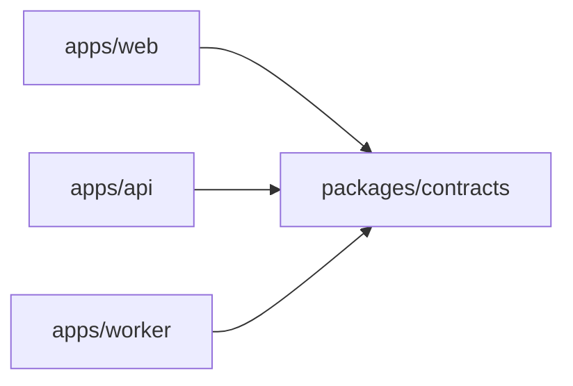

# @meet-first/contracts

The shapes, routes, jobs and errors that the apps and the worker share. Every name that crosses a boundary is defined here once.

## What this does

It holds the zod schemas for every route body and response, every meeting event, every background job and its payload, the quiz bank and the curated meeting questions, the environment variables each app reads at boot, the strict JSON schemas sent to the model, and the one error class every refusal uses.

## What this never does

It never calls the database, the model or the network. It never reads a file at runtime, except that the tests read the migration and the prompt schema files. It holds no state, and it imports no app code.

## How it fits



Notice that every name crosses a boundary through this package and nowhere else.

## The main pieces

- `primitives.ts`: the id, time and side shapes that every other file uses.
- `people/`, `sources/`, `cards/`, `meetings/`, `briefs/`: one folder per feature, each with the schemas and constants of that feature.
- `operations/`: errors, environment variables, job names and payloads, model call shapes and the operator views.
- `routes/`: one map per feature from route name to method, path, request and response. Both apps read paths from here.

## How to test it

```
pnpm test:unit packages/contracts
pnpm test:contracts packages/contracts
```

## Not built yet

- `sampleQuiz` needs the shuffle rule from the integrator (request `requests/build-w0-contracts-001.md`).
- `rowToEvent` needs its signature and the row shape from the integrator (request `requests/build-w0-contracts-002.md`).
- The import of `requestHash` into a contracts test needs a package rule from the integrator (request `requests/build-w0-contracts-003.md`).

This package changes only through `requests/` after the freeze (D75).
