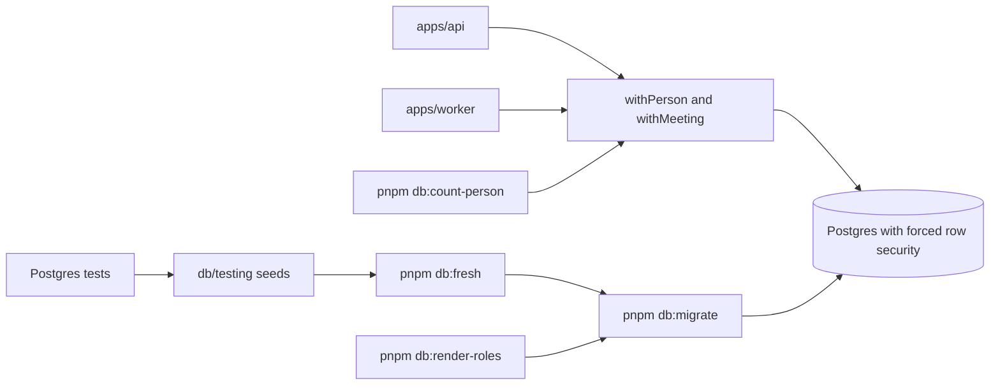

# packages/db

Rows D55, D56, D69, D71, and invariants 1 to 16 and 20.

## What this does

Every request and job reaches Postgres through this package. It opens the pooled client, runs each piece of work in one transaction that names the person or the meeting it acts for, and gives the Kysely types for every table of migrations 0001 and 0002. It also holds four commands (migrate, rebuild, count a person's rows, and the one-time role setup on Render) and the test seeds that other packages' Postgres tests start from.

## What this never does

It never sets both settings, or neither, in one transaction: the wrappers refuse. It never lets a role skip row security, and it never edits 0001_foundation.sql; a later change is a new numbered file that the integrator reviews. pnpm db:fresh never touches a database on another machine, and pnpm db:render-roles never prints a password or a URL. It stores no session token and no recovery code, only their hashes.

## How it fits



Notice that every arrow into Postgres passes through a wrapper or the migrate command, so nothing reads a table without naming a person or a meeting.

## The main pieces

- `src/client.ts`: the pooled client and the pool sizes, 10 for the api and 8 for the worker (D56).
- `src/transaction.ts`: withPerson and withMeeting, which set exactly one setting per transaction (D55).
- `src/types.ts`: one Kysely interface per table and view of migrations 0001 and 0002.
- `src/migrate.ts`: pnpm db:migrate under advisory lock 42, and the schema version check the worker runs at boot (D71).
- `src/fresh.ts`: pnpm db:fresh, which rebuilds a database on this machine from nothing.
- `src/count-person.ts`: pnpm db:count-person, which prints how many rows still point at a person (D69).
- `src/render-roles.ts`: pnpm db:render-roles, the one-time role setup on Render: it makes the four roles as the database's default user, hands the public schema to app_migrate, applies every migration, and writes the role URLs to git-ignored files.
- `src/database-errors.ts`: turns a trigger message or a duplicate into a stable code and a sentence.
- `src/recall-search.ts`: the recall lookup, full text first and trigram second (D38).
- `src/event-seq.ts`: the next seq of a meeting's event log, and the event append.
- `src/testing/`: freshTestDatabase, the context helpers and the seeds, imported as @meet-first/db/testing.
- `migrations/`: 0001_foundation.sql and 0002_names_review.sql (both frozen), ranges.txt and global-tables.txt.

## How to test it

Load the variables, then run these from the repository root:

```
set -a; . ./.env; set +a
pnpm db:fresh
pnpm test:security packages/db
pnpm test:integration packages/db
```

The .env needs DATABASE_URL_MIGRATE, DATABASE_URL_API, DATABASE_URL_WORKER, DATABASE_URL_TEST and DATABASE_URL_ADMIN. DATABASE_URL_ADMIN is a superuser of the Postgres on this machine, connected to its maintenance database, because only such a role may create the four roles and the databases.

Migrations 0003 onward arrive only through requests/.

For Render, put three lines in `.env.render` at the repository root: RENDER_DB_EXTERNAL_URL and RENDER_DB_INTERNAL_URL, the External and Internal Database URLs on the database's Info page, and APP_ORIGIN, the api service's address. Then run `pnpm db:render-roles`. It writes `.env.render-api` and `.env.render-worker`, both to paste into the one Render service, and `.env.wave3` for `scripts/check-wave-3.sh`. A second run gives the three login roles new passwords and writes the files again.
