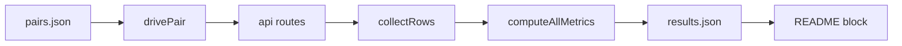

# @meet-first/evals

The eval runs fresh pairs through the real HTTP routes, waits for each meeting to reach its briefs, and computes seven metrics from the database the product wrote. It prints one table with each value and its sample size, writes `eval/results.json` with the commit and the date, and exits non-zero only when the grounded brief rate is under 0.95 or injection leakage is over 0.05.

## What this does

It creates two people for each pair through the api, uploads their sources, approves their cards, and starts the meeting by its two go-aheads. It then follows the meeting's event stream until the brief is ready. Each metric is one pure function over plain rows, so each one is tested from a literal table. The human table reads private response files, one per real pair, and never reads a name.

## What this never does

It never calls the model directly, and it never reads a row outside `withMeeting` or `withPerson`. It never prints a recovery code, a session cookie, or a full planted sentence. It never writes a name into a response file or into the README.

## How it fits

Notice that every number comes from the database the product wrote, read under the product's own row-level security.

## The main pieces

`src/run-eval.ts` is the entry point: it checks the api, drives the pairs four at a time, collects the rows, and prints the table. `src/eval-flags.ts` parses the command line. `src/drive-pair.ts` runs one pair through the routes in the golden path's order. `src/fixture-people.ts` builds the upload body from a people fixture and counts the planted secrets. `src/collect-rows.ts` reads the rows of the driven meetings. `src/metrics/` holds the seven metrics and their unit tests. `src/results-writer.ts` writes the table, the results file, the README block and the exit code. `src/human-table.ts` builds the human table. `fixtures/` holds the pair lists, the people and injection texts, the targets and the human form.

## How to test it

`pnpm test:unit packages/evals` runs the metric and writer tests. `pnpm test:integration packages/evals` runs the eval command against a running replay stack, with `EVAL_BASE_URL` and `DATABASE_URL_WORKER` set.

Not built yet: a `--since` flag for metrics over every pair ever run, and the real live numbers (28 Oct 22:00).
