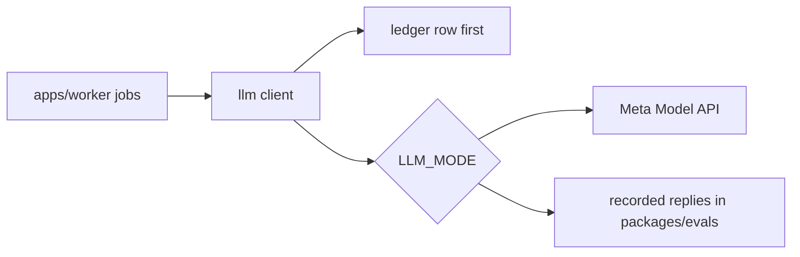

# @meet-first/llm

The model client lives here. Wave 0 wrote the call-site table, the three modes (live, record and replay) and the ledger functions; the dossier builder adds the client, the limiter, the caps and the retries in Wave 1 and rewrites this file.

## What this does

Every model call in the product goes through this package. It writes a ledger row before each call and answers from recorded replies in replay mode.

## What this never does

It never calls the model from anywhere but `apps/worker`, and it never skips the ledger row, because the spending caps read only the ledger.

## How it fits

A call always writes its ledger row before the mode decides where the reply comes from.

## The main pieces

`src/call-sites.ts` holds the settings for each call site. `src/modes.ts` runs one call in live, record or replay mode and computes the request hash. `src/ledger.ts` starts and finishes ledger rows and reads the three cross-person sums. `src/testing/replay-folder.ts` makes a fake fixture folder for tests.

## How to test it

`pnpm test:unit packages/llm`

Not built yet: the client, the limiter, the caps, the retries and the self-test, which the dossier builder writes in Wave 1.
