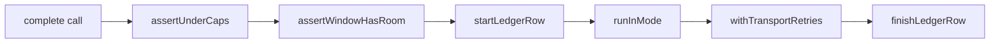
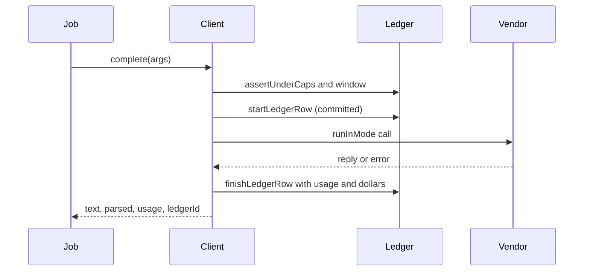

# @meet-first/llm

The one door to the Meta Model API. Every model call of the worker goes through this package, which writes a ledger row first, checks the dollar caps and the shared token window, runs the call in live, record or replay mode, retries 429 and 5xx itself, and writes the usage back.

## What this does

The one door to the Meta Model API. Every model call of the worker goes through this package, which writes a ledger row first, checks the dollar caps and the shared token window, runs the call in live, record or replay mode, retries 429 and 5xx itself, and writes the usage back.

## What this never does

It never calls the vendor without a ledger row already committed; it never retries inside the SDK; it never boots in replay in production; and it is never imported by apps/web or apps/api.

## How it fits

Notice that the ledger row exists before runInMode and is the only thing the limiter and the caps read.

## The main pieces

`src/client.ts` is the client every job calls, with the live callers and the streamed and image paths. `src/caps.ts` holds the two dollar caps and their copy. `src/limiter.ts` holds the shared token window and the re-enqueue. `src/self-test.ts` sends every output schema in a one-token call at boot. `src/config.ts` holds the model names, the prices and the limits. `src/chat-request.ts` builds the body of each call. `src/stream-reader.ts` reads and replays streamed replies. `src/retries.ts` holds our own retry rule. `src/ledger.ts` starts and finishes ledger rows. `src/testing/` holds the fake live caller, the environment for tests, the fixture writer and the folder of scripted replies tests replay.

## How to test it

`pnpm test:unit packages/llm` and `pnpm test:integration packages/llm`. Tests replay hand-written replies from `packages/evals/fixtures/scripted-replies`; the golden path and the eval replay the recordings of the real model in `packages/evals/fixtures/model-replies`.

Not built yet: the price check against the dashboard.
