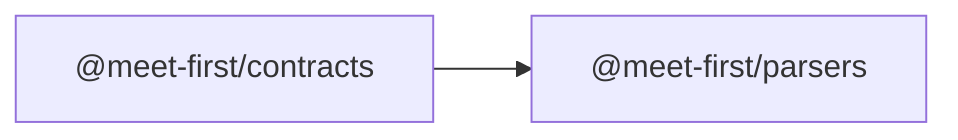

# @meet-first/parsers

This is a placeholder written at the Wave 0 freeze. The ingest builder replaces this file and the manifest in Wave 1.

## What this does

Reads chat exports into canonical turns, in the browser and on the server.

## What this never does

Nothing runs here yet: the folder holds only its manifest, so the workspace and the lock file are complete before Wave 1.

## How it fits

The package will read its shapes from contracts, like every other package.

## The main pieces

`package.json` lists the dependencies the Wave 1 specs pin (design-inputs/wave-1-seams.md S8). There is no source yet.

## How to test it

There is nothing to test until the ingest builder writes the package.

Not built yet: everything in this package.
