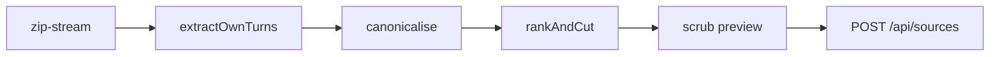

# @meet-first/parsers

## What this does

Turns an export file, a Codex session log or pasted notes into the uploader's own messages, in one canonical text form, ranked and cut to the size limits. It runs in the browser's Web Worker, and in Node for tests and the golden path script.

## What this never does

It never keeps or sends the raw file, never keeps a message written by an assistant, and never calls a server or a model. From a Codex session log it never keeps what Codex added to the person's messages (project instructions, context blocks, summaries), and it reads nothing from a session Codex ran for one of its own helpers, such as a sub-agent or a reviewer. It does not look for secrets; packages/scrub does that next.

## How it fits

Notice that the raw file never leaves the worker; only the kept canonical turns go up.

## The main pieces

- extract-own-turns.ts: the entry point, and which parser reads each file.
- chatgpt-shapes.ts: the two ChatGPT export shapes.
- claude-shapes.ts: the Claude export shape.
- codex-shapes.ts: the Codex session log (.jsonl), and which of its lines the upload keeps while it streams one.
- generic-walker.ts: the fallback for a shape nobody has seen yet.
- canonicalise.ts: canonical text and the language label.
- persona-signal.ts: the persona signal and the score each turn is ranked by.
- rank-and-cut.ts: the ranking and the size caps.
- index.ts: what other packages may import.
- fixtures/: one synthetic file per export shape.

## How to test it

Run `pnpm test:unit packages/parsers` from the repo root.

Not built yet: a parser release process for a new export shape; the user re-uploads after one.
