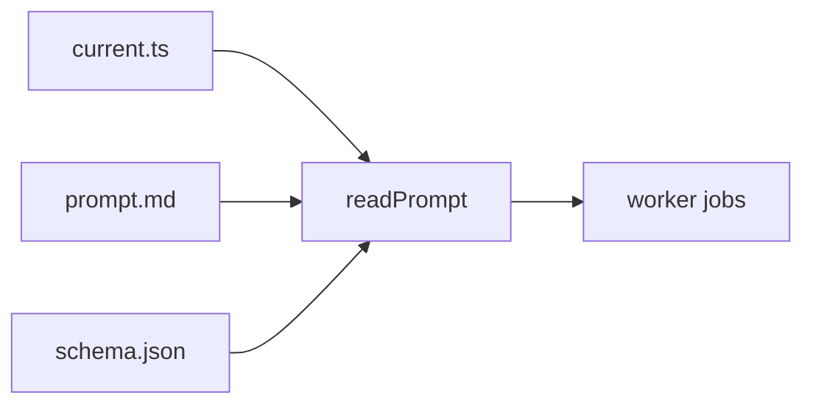

# @meet-first/prompts

The text of every model prompt, one folder per prompt and one folder per version, and the two functions that say which version is current and read it.

## What this does

The versioned prompt texts and the reader that loads them. Each prompt has a folder, each version a subfolder, and `src/current.ts` names the version each prompt sends today.

## What this never does

It never changes a prompt in place: a change is a new version folder plus one line in `current.ts`. It never calls the model and never reads the database.

## How it fits

Notice that the version comes from `current.ts` on every call, so one changed line changes what the next call sends.

## The main pieces

`src/current.ts` holds the version of each prompt and the list of prompt names. `src/read-prompt.ts` reads one prompt version from disk on every call. `src/index.ts` is the package's public surface. The prompt folders are `dossier`, `scrub-names` and `untrusted-data-rules` in this wave; each holds its `v1` text, a README, a CHANGELOG and its test cases.

## How to test it

`pnpm test:contracts packages/prompts` and `pnpm test:integration apps/worker/src/cards`.

Not built yet: the quiz, meeting, brief and comic prompt texts; each arrives with its builder, and `current.ts` already names them.
