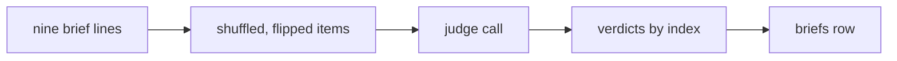

# brief-support-judge

## What this does

Checks, for each brief line, whether its quotes carry the line's main point. It returns one true or false verdict and a short reason per line.

## What this never does

It never sees which section a line came from, never sees the other person's brief, and never returns a score. It does not prove anything; its answer is a support rate that the brief shows as a rate.

## How it fits

Notice that the items are shuffled and flipped with a fixed rule, so the judge sees no section and no fixed position.

## The main pieces

- `v1/prompt.md`: the task text the judge reads.
- `v1/schema.json`: the strict output schema, converted from the contracts.
- `cases.md`: the test cases for the judge prompt, by kind.

## How to test it

Run `pnpm test:contracts packages/prompts` for the schema checks and `pnpm test:unit apps/worker/src/briefs` for the item order and the rate.

## What is not built yet

A second judge model and a calibration pair for this judge. Neither is in the Wave 2 inputs.
