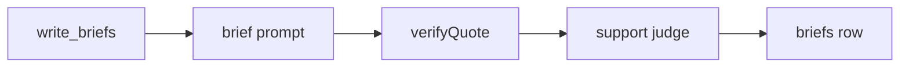

# brief

## What this does

Writes one recipient's nine brief lines: three where the two people agree, three where they clash, and three things to decide first. Every line carries one or two quotes copied from the meeting or the person's approved card.

## What this never does

It never gives a score, a percentage, a verdict on whether the two people should work together, an invented quote, or a line without a quote.

## How it fits

Notice that the support judge runs after the quote check and never sees the sections.

## The main pieces

- `v1/prompt.md`: the task text the model reads. The untrusted-data rules are added where its token stands.
- `v1/schema.json`: the strict output schema, converted from the contracts.
- `cases.md`: the test cases for the prompt, by kind.

## How to test it

Run `pnpm test:contracts packages/prompts` for the schema checks and `pnpm test:unit apps/worker/src/briefs` for the prompt input and quote checks.

## What is not built yet

A v2 prompt. Wave 3 recordings will show which rule the model breaks most often, and v2 follows that.
