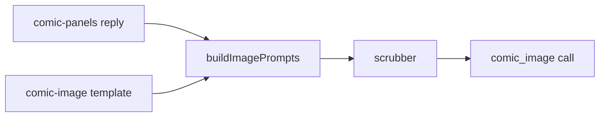

# comic-image prompt

A plain template for one panel image. The render_comic job fills it once for each of the six panels (D64, R11.3).

## What this does

It joins five pieces into one sentence-by-sentence image prompt: the fixed style prefix, the two avatar descriptors, the panel number and the panel's own image prompt. The filled text is what the scrubber checks and what the image model receives.

## What this never does

It never names a person. The job replaces both display names with "one person" and "the other person" before the template is filled. It has no output schema, because the reply is an image. It never edits a version in place: a change is a new `v2/` folder.

## How it fits

The template is filled in code, then scrubbed, then sent once per panel.

## The main pieces

- `v1/prompt.md`: the template text with five tokens, version 1, status draft.
- `cases.md`: the inventory and the test set.
- `CHANGELOG.md`: one row per version.

## How to test it

Run `pnpm test:unit apps/worker/src/comics`: the headline test fills all five tokens and checks that no token is left.

Not built yet: recorded runs of the test set in `cases.md`.
