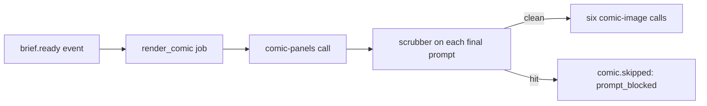

# comic-panels prompt

One model call that plans the six panels of a meeting comic: a caption and an image prompt for each panel (D64, R11.1).

## What this does

After a brief is ready, a person may ask for a comic. The render_comic job sends this prompt once, with the question, the two fixed characters and the headlines from the supported brief lines. The reply is six captions and six image prompts, checked against the strict schema in `v1/schema.json`.

## What this never does

It never sees a display name, a quote, a turn id or a card item. It never picks the characters; the two avatars come from the fixed list in the contracts package. It never edits a version in place: a change is a new `v2/` folder.

## How it fits

Each final image prompt goes through the scrubber before any image call; one hit refuses the whole comic.

## The main pieces

- `v1/prompt.md`: the prompt text, version 1, status draft.
- `v1/schema.json`: the strict output schema, six panels with a caption and an image prompt each.
- `cases.md`: the inventory and the test set.
- `CHANGELOG.md`: one row per version.

## How to test it

Run `pnpm test:unit apps/worker/src/comics` for the headline and prompt tests, and `pnpm test:integration apps/worker/src/comics` for the job with its replay fixtures.

Not built yet: recorded runs of the test set in `cases.md`.
