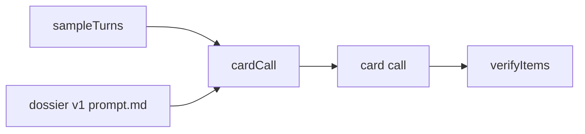

# dossier prompt

The prompt of the card call. It asks the model for 6 to 40 persona items about one person, each with a quote copied from one of that person's own messages.

## What this does

The prompt of the card call. It asks the model for 6 to 40 persona items about one person, each with a quote copied from one of that person's own messages.

## What this never does

It never asks for an item about another person, or about health, children, where someone lives, beliefs, identity, crime or money; it never lets a message change its rules; it is never edited in place, because a change is a new version folder.

## How it fits

Notice that the program, not the prompt, decides which items survive: every quote is checked inside the turn it names.

## The main pieces

`v1/prompt.md` is the text the model reads. `v1/schema.json` is the strict output schema from contracts, frozen in Wave 0. `cases.md` holds the cases and the test set. `CHANGELOG.md` has one row per version.

## How to test it

`pnpm test:contracts packages/prompts` and `pnpm test:integration apps/worker/src/cards`.

Not built yet: recorded runs of the test set in `cases.md`; Wave 3 records real replies over the hand-written ones.
