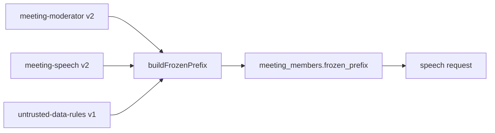

# meeting-moderator prompt

The rules every persona follows in a meeting: the agenda, the question's kind, the tools, likely reactions and what not to guess, and the decide turn (D31, D34, D37, D42, D43).

## What this does

This folder holds the text that starts the system message of every speech request in a meeting. It tells the persona whom it speaks for, how the three phases run, when to look up its human's notes, what to say when the notes are silent, and how to finish in the decide phase. Nobody is asked anything during a meeting: the two people let their personas meet so they do not have to.

## What this never does

It never carries meeting data: the question, the names, the card and the transcript are added after it by the step job. It is never edited in place: a change is a new `v2/` folder with a row in CHANGELOG.md, and only the prompts owner points `src/current.ts` at it.

## How it fits

Notice that this text comes first in the prefix, so the same bytes start every speech request of a side.

## The main pieces

- `v1/prompt.md`: the prompt text, version 1, status draft.
- `cases.md`: the channels, tools, attacks, conflicts and failures the text answers, and its test set.
- `CHANGELOG.md`: one row per version.

## How to test it

Run `pnpm test:unit apps/worker/src/meetings`. It checks that this text and meeting-speech hold at least 16,000 characters together and that a side's prefix is the same bytes on two builds. The test set in `cases.md` has no recorded runs yet.

Not built yet: recorded runs of the test set, and a v2 written from them.
