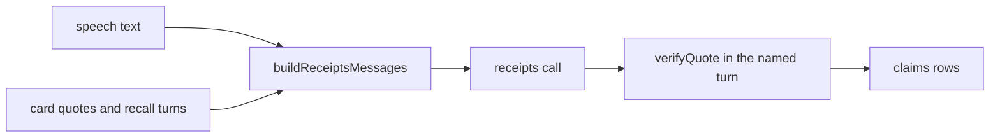

# meeting-receipts prompt

The second call of every persona turn: it lists the claims of the speech that rest on the human's own words, each with an exact quote from one named turn (D26, D27, D39).

## What this does

After a persona speaks, this prompt asks the model for the claims the speech made about its human, each with a quote copied from one of the turns shown to it: the human's approved card quotes and the notes recall found in this turn. The step job then checks every quote inside the one turn it names.

## What this never does

It never decides whether a claim is true, and it never changes the speech. It never sees the other human's turns as citable, so a persona cannot cite the other human's words as its own. It is never edited in place: a change is a new `v2/` folder.

## How it fits

Notice that the model's quote is never trusted: verifyQuote checks it inside one turn, and a failed claim is regenerated once, then stored as no receipt.

## The main pieces

- `v1/prompt.md`: the prompt text, version 1, status draft.
- `v1/schema.json`: the strict output schema from Wave 0, the same as ReceiptsOutput.
- `cases.md`: the inventory and the test set.
- `CHANGELOG.md`: one row per version.

## How to test it

Run `pnpm test:unit apps/worker/src/meetings` for the claim checks and the one regeneration, and `pnpm test:integration apps/worker/src/meetings` for a fabricated quote stored as flagged. The test set in `cases.md` has no recorded runs yet.

Not built yet: recorded runs of the test set.
