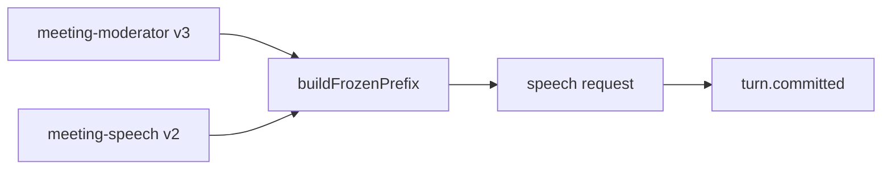

# meeting-speech prompt

How a persona speaks in a meeting: its voice, how it uses its card, how it says a likely reaction, languages, people and privacy, honesty and refusals (D43, R6.3, R7.3).

## What this does

This folder holds the second part of the system message of every speech request. The moderator text before it says what the persona does in each phase; this text says how it talks while doing it, so both screens read a persona that sounds like a careful representative of its human.

## What this never does

It never lists meeting data and never sets the agenda: those come from the moderator text and the step job. It is never edited in place: a change is a new `v2/` folder with a row in CHANGELOG.md.

## How it fits

Notice that this text shapes the words of every committed turn, while the moderator text decides which turns and tools happen.

## The main pieces

- `v1/prompt.md`: the prompt text, version 1, status draft. Its version string is the promptVersion of every speech call.
- `cases.md`: the inventory and the test set.
- `CHANGELOG.md`: one row per version.

## How to test it

Run `pnpm test:unit apps/worker/src/meetings`, which checks the prefix that holds this text. The test set in `cases.md` has no recorded runs yet.

Not built yet: recorded runs of the test set, and a v2 written from them.
