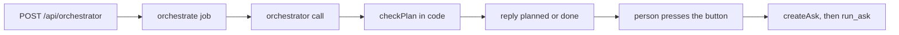

# orchestrator prompt

Meety, the person's personal AI (called the orchestrator in the code), reads one chat message from a person and plans exactly one action: a help search across Explore, a friend ask to one friend's agent, or a reply in words only (wave 7).

## What this does

The orchestrate job sends this text as the system message of one orchestrator call. The user message holds up to the last 10 messages of the person's chat (2,400 characters at most, the oldest left out first), their friend list with each friend's switch, and the new message. The reply is one JSON object with the action, the friend for a friend ask, the question the ask will carry, and the words shown to the person above the button.

## What this never does

It never starts an ask: the person presses the button, and the api starts it through the same checks as a button press anywhere else. It never answers for a person or guesses a reaction, and it never answers the question an ask would carry, such as a sum or a fact. Code checks its friend against the list the person had when they sent the message. It is never edited in place: a change is a new version folder, the next one `v4/`, with a row in CHANGELOG.md.

## How it fits

Notice that the model only proposes: checkPlan decides the action, and nothing reaches another agent before the person's press.

## The main pieces

`v3/prompt.md` is the system message. It keeps every rule of v2 and adds reading a question sent in pieces: the latest message is read with the earlier messages it continues, Meety asks at most one question back for each question, and after that it plans its best guess for the person to press or correct (v2 read each message on its own; v1 is v2 without the name Meety). `v3/schema.json` is OrchestratorPlanOutput from packages/contracts, converted to a strict schema. `cases.md` holds the inventory and the test set. The request builder and the checks are in apps/worker/src/orchestrator/plan-requests.ts.

## How to test it

`pnpm exec vitest run --project unit apps/worker/src/orchestrator` for the checks in code. The prompt's own test set is in cases.md, with the 3 Nov chat that motivated v3. In results.md, v3's final text has 3 recorded runs of every test, and ORC-T44 passed 2 of 3, so v3 is a draft.
