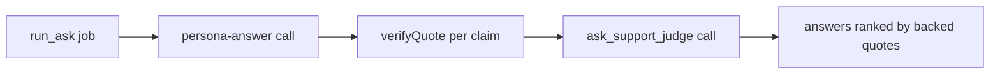

# persona-answer prompt

One persona answers one question about its own person: in a help search, whether that person could probably help with a stuck problem and how; in a friend ask, how that person would probably react to something (as-built item 49).

## What this does

The run_ask job sends this text, then the untrusted-data rules, as the system message of one persona_answer call. The user message holds the ask, the two names, the card items the persona may use and, when the person switched recall on, a few of their own messages found for the ask. The reply is a short hedged answer with up to three claims, each with an exact quote and its turn label, which the program checks inside the named turn.

## What this never does

It never solves the asker's problem, promises the person's time or money, scores the person, or speaks on a topic the person's quiz showed is a wrong guess. It is never edited in place: a change is a new `v2/` folder with a row in CHANGELOG.md.

## How it fits

