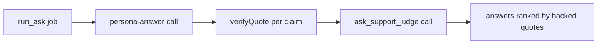

# persona-answer prompt

One persona answers one question about its own person: in a help search, whether that person could probably help with a stuck problem and how; in a friend ask, how that person would probably react to something (as-built item 49).

## What this does

The run_ask job sends this text, then the untrusted-data rules, as the system message of one persona_answer call. The user message holds the ask, the two names, the card items the persona may use and, when the person switched recall on, all of their messages when they have at most 40, or else the ones found with the search words (search-words prompt) and a spread of the rest; for a friend ask when the summary's friends switch is on, the points of the summary their own AI wrote, those found in their messages apart from those that were not. The reply is a short answer with up to three claims, as firm as the person's own words, each with an exact quote and its turn label; when nothing speaks to a friend's question, however odd it is, the answer is a prediction from who the person is that says it is a guess and quotes what it rests on, which the program checks inside the named turn. v2's recorded runs are in results.md.

## What this never does

It never solves the asker's problem, promises the person's time or money, scores the person, says yes or no to a date for them, or speaks on a topic the person's quiz showed is a wrong guess. It is never edited in place: a change is a new `v2/` folder with a row in CHANGELOG.md.

## How it fits

