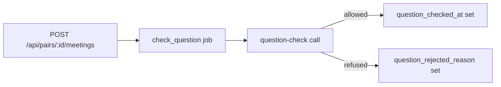

# question-check prompt

One small model call that decides whether a typed meeting question may start a meeting (R10.5).

## What this does

When a person types their own meeting question instead of picking one of the 12 curated ones, the check_question job sends it here once. The answer is allowed or not, with one sentence the start screen can show, and the question's kind (get_along, help, situation, decision, deal, debate or romance), which the meeting and the brief follow. It refuses sexually explicit questions. From v3 it also judges asks about one person's persona: how a friend would probably react, and help requests sent to many personas.

## What this never does

It never answers or rewrites the question. It never runs for a curated question, which is checked when the meeting is created. It is never edited in place: a change is a new `v2/` folder.

## How it fits

Notice that a refused question leaves the meeting unable to start, and the start route shows the reason.

## The main pieces

- `v1/prompt.md`: the prompt text, version 1, status draft.
- `v1/schema.json`: the strict output schema from Wave 0, the same as QuestionCheckOutput.
- `cases.md`: the inventory and the test set.
- `CHANGELOG.md`: one row per version.

## How to test it

Run `pnpm test:integration apps/worker/src/meetings`: the check-question tests replay an allowed and a refused verdict. The test set in `cases.md` has no recorded runs yet.

Not built yet: recorded runs of the test set.
