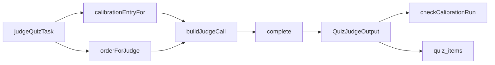

# quiz-judge

The prompt for the `quiz_judge` call site (D30, R4.4, R4.6).

## What this does

This prompt asks the model whether two answers to one quiz question give the same main point. It returns true or false and one sentence of reason. The worker sends it for each of the ten items of a quiz and for the two calibration pairs of each judging run, so a judge that drifts or turns lenient shows up inside every quiz.

## What this never does

- It is never told which answer is the person's and which is the persona's, and the order changes per item (D30).
- It never gives partial credit; the verdict is true or false.
- It never follows text inside an answer that is addressed to a model.
- It never calls a tool or takes an action; its output is one JSON object.

## How it fits



Notice that the calibration pairs and the real items reach the judge through the same call, so the judge cannot tell them apart.

## The main pieces

- `v1/prompt.md`: the system message, version 1, status draft.
- `v1/schema.json`: the strict output schema, written in Wave 0 and frozen.
- `cases.md`: the inputs, attacks, conflicts and failure branches the prompt was written against, and its test set.
- `CHANGELOG.md`: one row per version, with the checks and reads behind it.

## How to test it

The quiz job tests replay recorded replies for this prompt:

```
pnpm test:integration apps/worker/src/quizzes
```

The prompt's own test set in `cases.md` runs each case 3 times against the live model. None has run yet.

Not built yet: the 3 recorded runs of each case in `cases.md`, and a reader other than the writer for the two reads.
