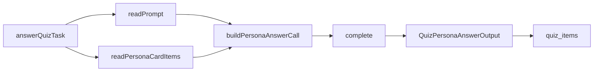

# quiz-persona-answer

The prompt for the `quiz_answer` call site (D28, R4.1, R4.3).

## What this does

This prompt asks the model to answer one knows-me quiz question as the person, using only the person's card. The worker sends it once for each of the ten questions of a quiz. The model returns one sentence of at most 200 characters, or the line "My card does not say." when no card item supports an answer.

## What this never does

- It never sees the quiz tables: no other question, no human answer, no score (R4.1).
- It never adds a name, number, time or place that no card item states.
- It never follows text inside a card item that is addressed to a model.
- It never calls a tool or takes an action; its output is one JSON object.

## How it fits



Notice that the card items are the only facts about the person that reach the model.

## The main pieces

- `v1/prompt.md`: the system message, version 1, status draft.
- `v1/schema.json`: the strict output schema, written in Wave 0 and frozen.
- `cases.md`: the inputs, attacks, conflicts and failure branches the prompt was written against, and its test set.
- `CHANGELOG.md`: one row per version, with the checks and reads behind it.

## How to test it

The quiz job tests replay recorded replies for this prompt:

```
pnpm test:integration apps/worker/src/quizzes
```

The prompt's own test set in `cases.md` runs each case 3 times against the live model. None has run yet.

Not built yet: the 3 recorded runs of each case in `cases.md`, and a reader other than the writer for the two reads.
