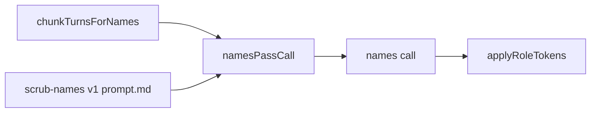

# scrub-names prompt

The prompt of the names pass. It asks the model for every name of a person other than the writer in one chunk of the writer's messages, with a role for each, so the program can replace the names before anyone reads the source.

## What this does

The prompt of the names pass. It asks the model for every name of a person other than the writer in one chunk of the writer's messages, with a role for each, so the program can replace the names before anyone reads the source.

## What this never does

It never returns the writer's own name or declared organisations, never rewrites the text itself, and is never edited in place.

## How it fits

Notice that the model only lists names; the program does every replacement, and the allowlist is checked again in code.

## The main pieces

`v1/prompt.md` is the text the model reads. `v1/schema.json` is frozen in Wave 0. `cases.md` holds the cases and the test set. `CHANGELOG.md` has one row per version.

## How to test it

`pnpm test:contracts packages/prompts` and `pnpm test:integration apps/worker/src/cards`.

Not built yet: recorded runs of the test set in `cases.md`; Wave 3 records real replies over the hand-written ones.
