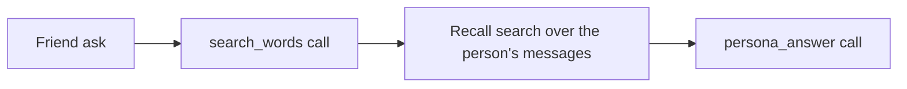

# search-words

## What this does

Before a friend ask searches a person's messages, this prompt turns the ask into the words that person would have written about it, using the topics from their checked summary. "Your startup" becomes "Rentably", so the search finds the message the question is about.

## What this never does

It never answers the question, never names people, and never runs for a help search. When its call fails, the ask job searches with the ask's own words.

## How it fits

## The main pieces

- `v1/prompt.md` and `v1/schema.json`: the prompt and its reply shape, `SearchWordsOutput` in contracts.
- `cases.md`: the cases it covers and its tests; `results.md`: their recorded live runs.
- `apps/worker/src/asks/search-words.ts`: the request and the query the reply becomes.

## How to test it

`pnpm exec vitest run --project unit apps/worker/src/asks` for the request and the query; the prompt's own tests are in cases.md.

Not built yet: nothing.
