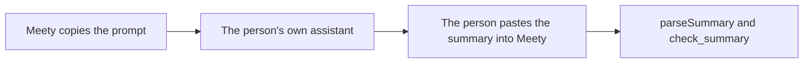

# summary-request

## What this does

The prompt a person copies from Meety into their own ChatGPT, Claude or other assistant. That assistant, which already knows their history, writes a summary of them in Meety's block format: Kind, Topic, Point, Strength and up to three Quote lines per point.

## What this never does

Meety never sends this prompt to a model itself; the person's own assistant runs it. It never asks for health, private details about other people, contact details or ID numbers.

## How it fits

The person reads the summary before Meety stores it, and can remove any point.

## The main pieces

- `v1/prompt.md`: the prompt; the web app copies everything after its version block.
- `cases.md`: the cases it covers and its tests.

## How to test it

Paste `v1/prompt.md` into ChatGPT and into Claude with history on, then run the tests in `cases.md` on what comes back.

Not built yet: nothing.
