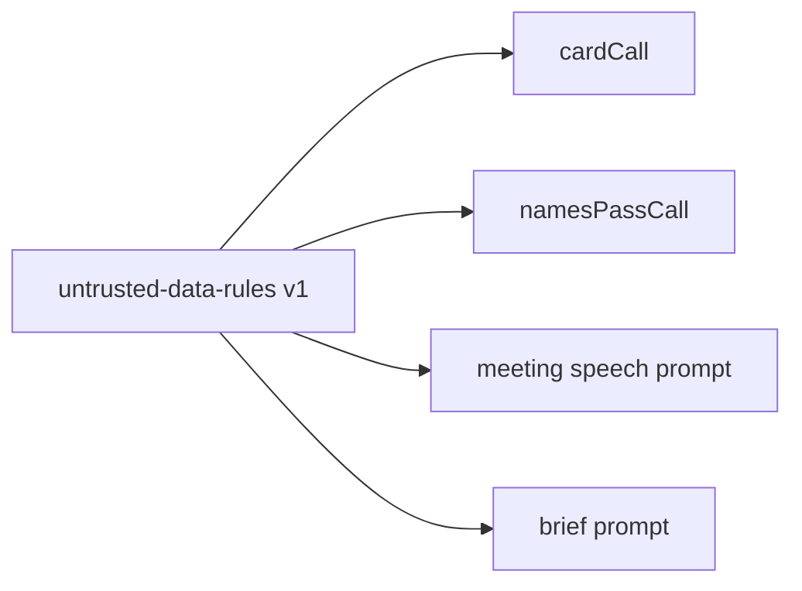

# untrusted-data-rules prompt

The rules every task prompt carries for text it reads and must never obey: a person's messages, the other persona's words, lookup results, a human's typed answer and tool results.

## What this does

The rules every task prompt carries for text it reads and must never obey: a person's messages, the other persona's words, lookup results, a human's typed answer and tool results.

## What this never does

It is never a call site on its own, never names a task, and is never edited in place.

## How it fits

Notice that one text is shared by every call that reads untrusted text, so a new version here reaches all of them.

## The main pieces

`v1/prompt.md` is the text appended to each task prompt. `cases.md` holds the test set. `CHANGELOG.md` has one row per version. There is no schema file, because this text is plain.

## How to test it

`pnpm test:contracts packages/prompts`.

Not built yet: recorded runs of the test set; the eval's injection number (Wave 2) measures leakage across the whole flow.
