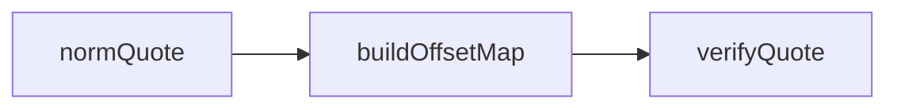

# @meet-first/receipts

The quote checker. It decides whether a quote the model gave appears in the turn the model named, and where.

## What this does

It normalises text the same way for both sides of a comparison, maps every position of the normalised text back to the original text, and checks one quote against one turn. It returns the first rule a quote breaks, or the exact slice of the original turn the quote covers.

## What this never does

It never reads a file, a database or the network. It never looks at more than one turn at a time, so a quote that spans two turns always fails. It never accepts a quote that is too short to prove anything.

## How it fits



Notice that verifyQuote looks inside one turn only; a quote that spans two turns can never match.

## The main pieces

- `src/norm-quote.ts`: the normalisation steps and the character map.
- `src/offset-map.ts`: the map from normalised positions back to original positions, in UTF-16 code units.
- `src/verify-quote.ts`: the checks and the result.
- `fixtures/quotes/`: thirty quote fixtures, each a JSON file with a turn, a quote and the expected outcome.

## How to test it

```
pnpm test:unit packages/receipts
```

## Not built yet

Nothing.
