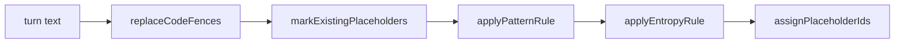

# @meet-first/scrub

## What this does

Finds secrets, contact details and identity numbers in a message and replaces each with a placeholder that says what was there, such as [redacted:email:00000001]. A code fence becomes one line such as [code: python, 12 lines]. The browser runs it to show the count before upload, and the API runs it again before anything is stored.

## What this never does

It never looks for people's names; the names pass in apps/worker does that. It never keeps what it replaced and never stores where it was. It is not perfect: a secret shorter than 20 characters with no label, or a phone number written in words, gets through.

## How it fits

Notice that code fences go first, so nothing inside a fence is ever matched or kept.

## The main pieces

- scrub.ts: the one scrub function, which runs every step in order.
- code-fences.ts: code fences become placeholders first.
- secret-patterns.ts: keys, tokens, private keys and URLs with passwords.
- identifier-patterns.ts: emails, phones, cards, IBANs, NRIC, Aadhaar, PAN and postal codes.
- entropy.ts: long random-looking tokens.
- placeholders.ts: placeholder ids, and finding and counting placeholders.
- index.ts: what other packages may import.
- fixtures/: the 40 planted secrets, prose that must pass untouched, and a fenced env file.

## How to test it

Run `pnpm test:unit packages/scrub` and `pnpm test:security packages/scrub` from the repo root.

Not built yet: a rule for street addresses written in words, and a re-scrub of old sources when SCRUB_VERSION changes; a new version means a new upload.
